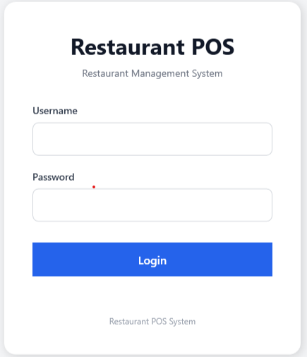
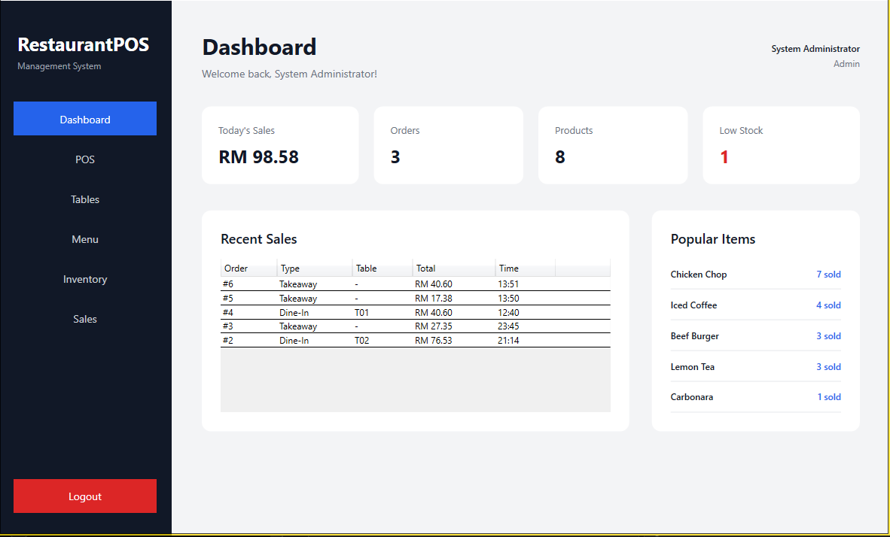
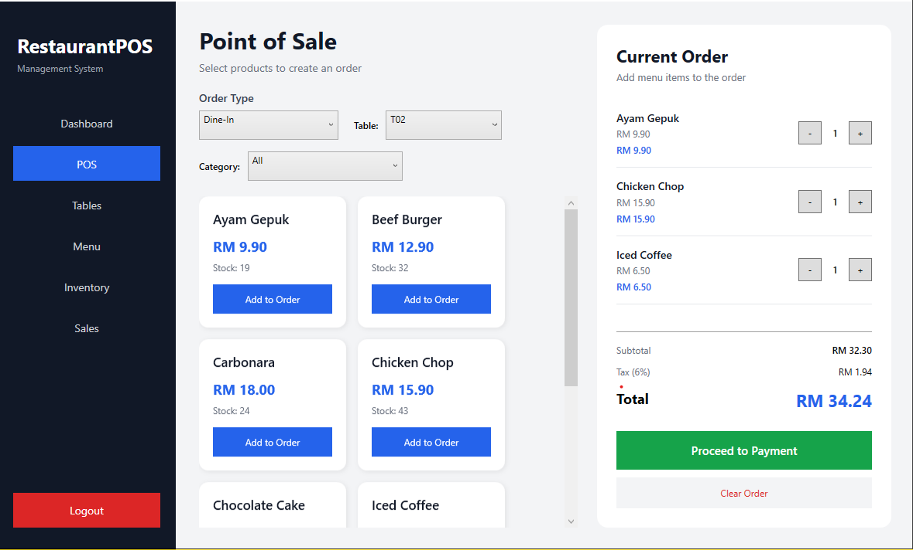
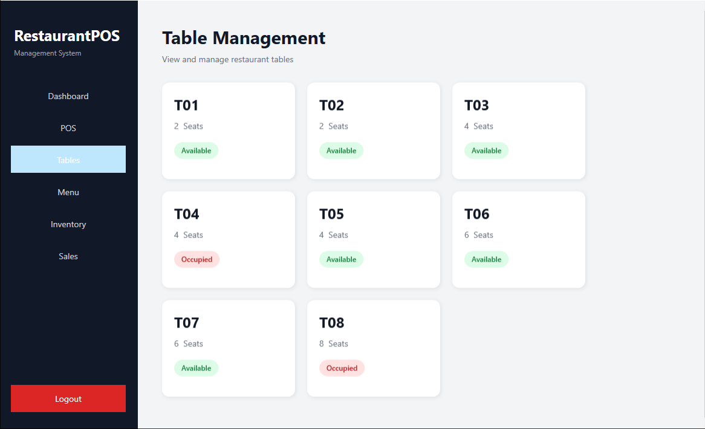
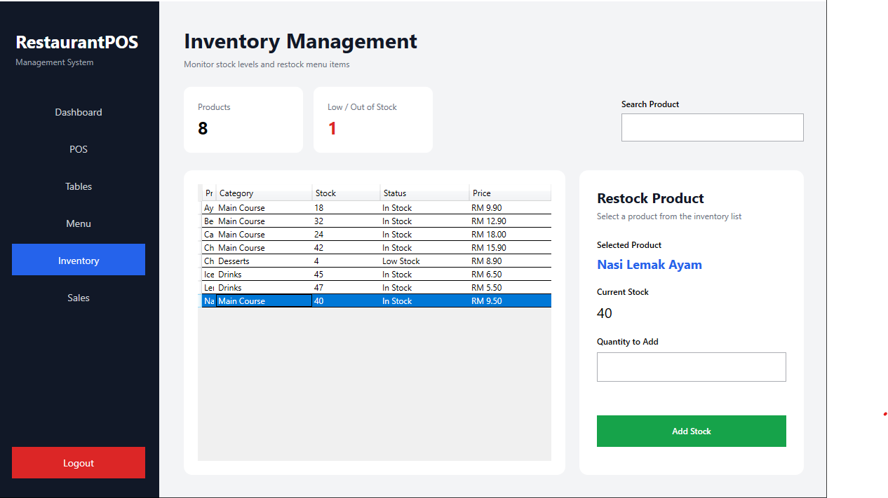
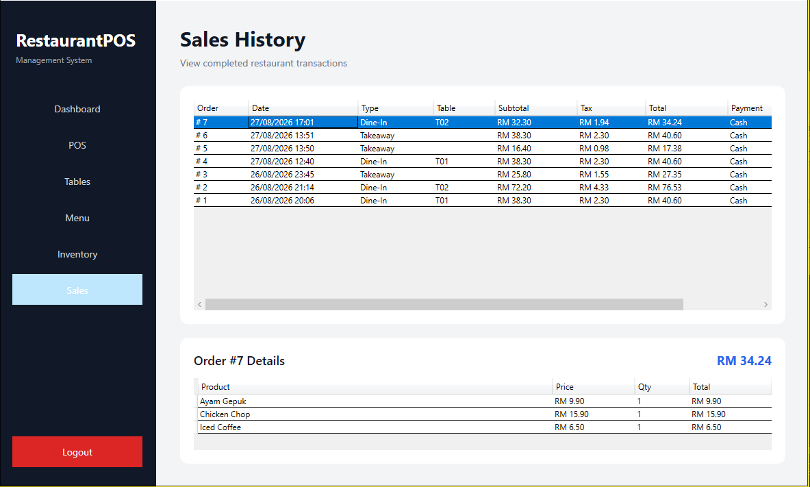
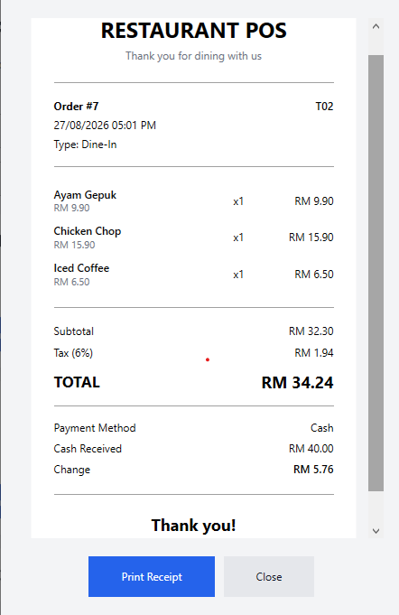

* Increase and decrease item quantity
* Automatic subtotal calculation
* 6% tax calculation
* Automatic total calculation
* Stock availability validation
* Prevent ordering more items than available stock

### Table Management

* Restaurant table management
* Table capacity tracking
* Table statuses:

  * Available
  * Occupied
  * Reserved
* Dine-in orders can be assigned to a table
* Selected tables automatically become occupied
* Tables automatically become available again after payment

### Payment

* Cash payment
* Amount received validation
* Automatic change calculation
* Prevent payment when cash received is insufficient
* Database transaction support to ensure order and stock updates remain consistent

### Menu Management

* Add menu items
* Edit product details
* Update prices
* Assign product categories
* Update stock quantity
* Activate or deactivate menu items
* Deactivated products are automatically hidden from the POS screen

### Inventory Management

* Current stock monitoring
* Product search
* Restocking
* Automatic stock deduction after completed sales
* Inventory status:

  * In Stock
  * Low Stock
  * Out of Stock
* Low-stock warning for products with 5 units or fewer

### Sales History

* View completed orders
* Order number
* Date and time
* Dine-In / Takeaway
* Restaurant table
* Subtotal
* Tax
* Total
* Payment method
* Detailed items for each order

### Dashboard

* Today's total sales
* Today's order count
* Total products
* Low-stock product count
* Recent sales
* Best-selling products

### Receipt

* Automatic receipt generation after successful payment
* Order details
* Product quantities and prices
* Subtotal
* Tax
* Total
* Cash received
* Change
* Windows Print Dialog support
* Can be printed using Microsoft Print to PDF

### Testing

* Unit testing using xUnit
* Tests for:

  * Empty cart calculations
  * Single-product calculations
  * Multiple-product calculations
  * Quantity and total calculations

## Tech Stack

| Technology            | Purpose                          |
| --------------------- | -------------------------------- |
| C#                    | Main programming language        |
| .NET 10               | Application framework            |
| WPF                   | Desktop application UI           |
| XAML                  | WPF interface design             |
| Entity Framework Core | ORM and database operations      |
| SQLite                | Local relational database        |
| LINQ                  | Data querying and transformation |
| BCrypt.Net            | Password hashing                 |
| xUnit                 | Unit testing                     |
| Git                   | Version control                  |
| GitHub                | Source code hosting              |

## Application Architecture

The application uses an **MVVM-inspired structure** with separation between application models, views, services, database access, and supporting components.

```text
RestaurantPOS
│
├── Converters
│   └── WPF value converters
│
├── Data
│   ├── AppDbContext
│   └── DatabaseSeeder
│
├── Models
│   ├── User
│   ├── Product
│   ├── Category
│   ├── RestaurantTable
│   ├── CartItem
│   ├── Order
│   └── OrderItem
│
├── Services
│   ├── AuthService
│   └── OrderCalculationService
│
├── ViewModels
│   └── LoginViewModel
│
├── Views
│   ├── LoginView
│   ├── DashboardView
│   ├── POSView
│   ├── TablesView
│   ├── MenuView
│   ├── InventoryView
│   ├── SalesView
│   ├── PaymentWindow
│   └── ReceiptWindow
│
├── Migrations
│
└── RestaurantPOS.Tests
```

## Order Workflow

```text
Login
  ↓
Dashboard
  ↓
POS
  ↓
Dine-In / Takeaway
  ↓
Select Table (Dine-In)
  ↓
Select Products
  ↓
Cart
  ↓
Subtotal + Tax + Total
  ↓
Cash Payment
  ↓
Save Order
  ↓
Save Order Items
  ↓
Deduct Inventory
  ↓
Release Table
  ↓
Generate Receipt
  ↓
Sales History / Dashboard
```

## Role Permissions

| Feature              | Admin | Cashier |
| -------------------- | :---: | :-----: |
| Dashboard            |   ✅   |    ✅    |
| POS                  |   ✅   |    ✅    |
| Table Management     |   ✅   |    ✅    |
| Sales History        |   ✅   |    ✅    |
| Menu Management      |   ✅   |    ❌    |
| Inventory Management |   ✅   |    ❌    |

## Screenshots

### Login



### Dashboard



### Point of Sale



### Table Management



### Inventory Management



### Sales History



### Receipt



## Getting Started

### Requirements

* Windows 10 or Windows 11
* Visual Studio with the **.NET desktop development** workload
* .NET 10 SDK

### Run the Application

Clone the repository and enter the project folder:

```bash
git clone https://github.com/harry012304/RestaurantPOS.git
cd RestaurantPOS
```

Open:

```text
RestaurantPOS.slnx
```

in Visual Studio.

Restore the NuGet packages if required, then build the solution.

```text
Build → Build Solution
```

Run the application:

```text
F5
```

Entity Framework Core migrations are automatically applied when the application starts.

## Demo Accounts

For development/demo purposes:

```text
Admin
Username: admin
Password: admin123
```

```text
Cashier
Username: cashier
Password: cashier123
```

These accounts are intended for demonstration only.

## Unit Tests

Open:

```text
Test → Test Explorer
```

and select:

```text
Run All Tests
```

The current test suite verifies important POS calculation logic including subtotal, tax, quantity, and total calculations.

## Database

RestaurantPOS uses **SQLite** together with **Entity Framework Core**.

The local database file is excluded from Git using `.gitignore`.

Database structure is recreated using the Entity Framework Core migrations included in the repository.

Main entities include:

```text
User
Category
Product
RestaurantTable
Order
OrderItem
```

Relationships include:

```text
Category
   └── Products

RestaurantTable
   └── Orders

Order
   └── OrderItems

Product
   └── OrderItems
```

## Key Technical Concepts Demonstrated

* Object-Oriented Programming with C#
* WPF desktop development
* XAML user interface development
* MVVM-inspired application structure
* CRUD operations
* Entity Framework Core ORM
* SQLite database integration
* LINQ querying
* Asynchronous programming with `async/await`
* Authentication and BCrypt password hashing
* Role-based authorization
* Database relationships
* Database migrations
* Database transactions
* Inventory management
* POS business logic
* Receipt generation and printing
* Unit testing with xUnit
* Git and GitHub version control

## Future Improvements

Potential future enhancements include:

* Barcode scanner support
* QR / card / e-wallet payments
* Product images
* Supplier management
* Purchase orders
* Custom low-stock thresholds
* Customer management
* Restaurant reservations
* Sales charts
* Export reports to PDF or Excel
* Cloud database synchronization
* Multiple restaurant branches

## Project Purpose

RestaurantPOS was developed as a portfolio project to strengthen practical experience in **C#, .NET, WPF, database development, testing, and Point of Sale system development**.

The project focuses on implementing realistic restaurant workflows rather than only basic CRUD functionality.

## Author

**Muhammad Syamil**

Computer Science Student
Software Development Portfolio Project
